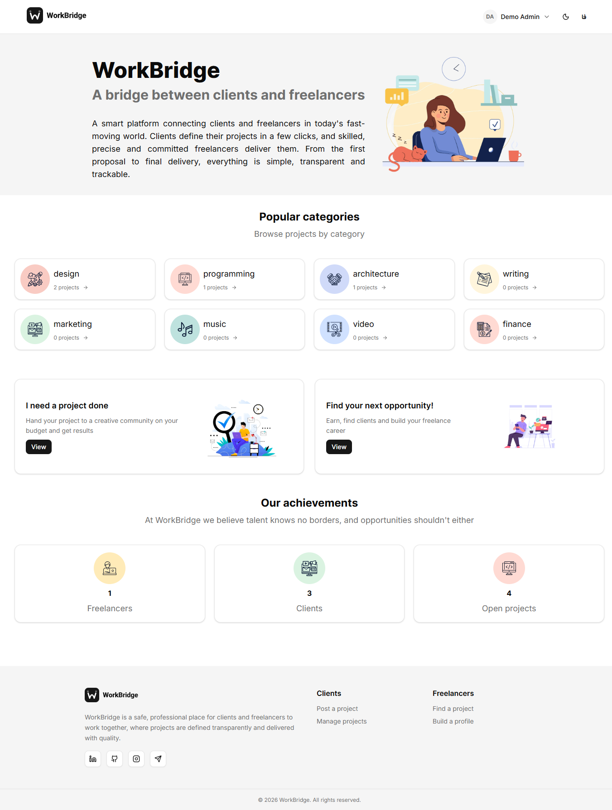
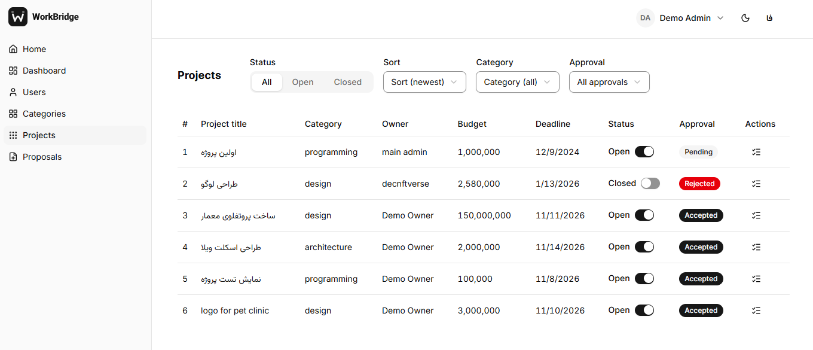

# WorkBridge

A freelancing platform that connects project owners with freelancers. Owners post projects and review proposals, freelancers browse projects and send proposals, and admins manage users and categories. Login is by phone number with a one-time password (OTP). The UI is bilingual (Persian RTL and English) with light and dark themes.




## Features

- **OTP login** by phone number, then profile completion with a role
- **Owner**: create, edit, delete and open/close projects; accept or reject proposals
- **Freelancer**: browse and filter projects, submit proposals, track submitted ones
- **Admin**: verify or block users, view all projects and proposals, manage categories
- Role-based dashboards with a sidebar layout per role
- **Persian and English** (i18next) with RTL/LTR switching, localized numbers and dates
- Dark mode
- Security hardening on the API: Helmet, rate limiting, Zod validation, httpOnly JWT cookies with refresh

## Tech stack

| Part               | Stack                                                                                                             |
| ------------------ | ----------------------------------------------------------------------------------------------------------------- |
| Client (`client/`) | React 19, Vite, TypeScript, Tailwind CSS 4, React Router 7, TanStack Query, React Hook Form + Zod, i18next, Axios |
| Server (`server/`) | Node.js, Express 5, TypeScript, MongoDB + Mongoose 9, Zod, JWT, Helmet, express-rate-limit                        |
| Testing            | Vitest (client and server), Playwright end-to-end, visual and accessibility (axe) tests, GitHub Actions CI        |

## Getting started

Requirements: Node.js 18+ (CI uses 24) and a running MongoDB.

```bash
git clone https://github.com/parisa-adli/WorkBridge.git
cd WorkBridge
npm install
npm install --prefix client
npm install --prefix server
cp server/.env.example server/.env   # set APP_DB and the secret keys
npm run dev                          # API on :5000, client on :3000
```

The client calls `http://localhost:5000/api` by default; set `VITE_BASE_URL` in `client/.env` to use another API. In development the OTP code is printed in the server console.

## Scripts

| Where           | Command                              | What it does                                           |
| --------------- | ------------------------------------ | ------------------------------------------------------ |
| root            | `npm run dev`                        | Server and client together                             |
| root            | `npm run e2e`                        | Playwright end-to-end tests                            |
| client / server | `npm test`                           | Unit and integration tests (Vitest)                    |
| client / server | `npm run lint` · `npm run typecheck` | ESLint and TypeScript checks                           |
| client          | `npm run i18n:check`                 | Checks that `fa.json` and `en.json` have the same keys |

## Project structure

```
client/src/
  features/   # auth, projects, proposals, owner, freelancer, admin
  pages/      # route pages
  services/   # API calls
  i18n/       # fa / en translations
  ui/         # shared components
server/
  app/router/ # /user, /category, /project, /proposal, /admin
  app/http/   # controllers, middlewares, validators
  app/models/ # Mongoose models
  tests/      # Vitest + Supertest suites
e2e/          # Playwright specs and screenshot baselines
```
